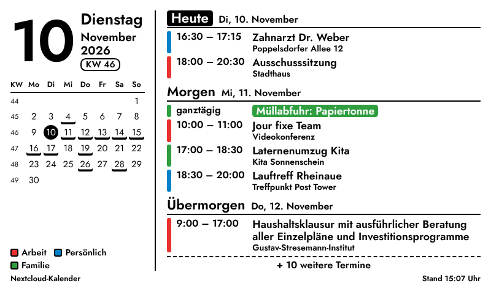
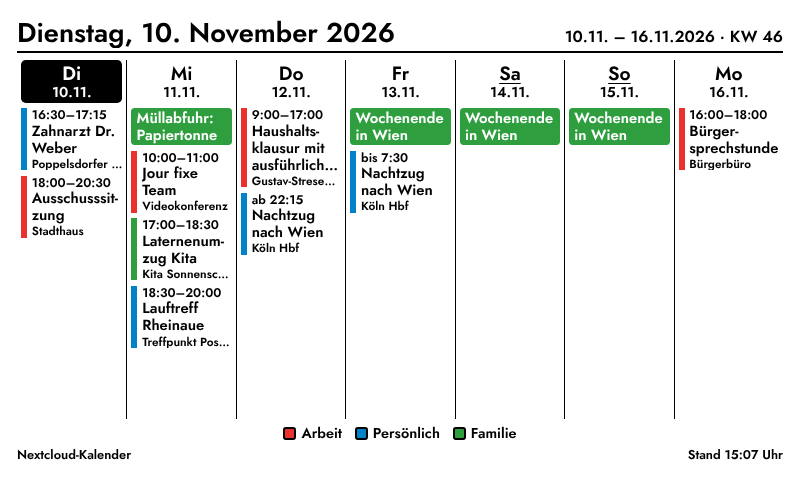
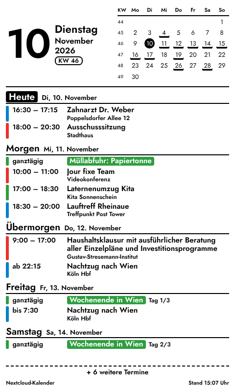

# InkyPi – Nextcloud Kalender

Ein InkyPi-Plugin, das Termine per CalDAV direkt aus Nextcloud liest, auch aus privaten Kalendern, und sie auf Deutsch als Terminliste oder Wochenansicht anzeigt.





*Die Screenshots zeigen Testtermine.*

## Funktionen

- **Terminliste:** Termine der nächsten 3, 7, 14 oder 30 Tage, nach Tagen gruppiert („Heute“, „Morgen“, „Übermorgen“ …). Daneben ein großes Datum, die Kalenderwoche und eine Monatsübersicht, in der Tage mit Terminen markiert sind.
- **Wochenansicht:** 7 Spalten, beginnend mit heute oder mit dem Montag der laufenden Woche.
- **Serientermine** samt Ausnahmen (verschobene oder ausgefallene Termine) werden korrekt aufgelöst. Abgesagte Termine werden ausgeblendet.
- **Ganztägige und mehrtägige Termine** erscheinen als farbige Markierung mit „Tag 2/3“. Termine über Mitternacht werden als „ab 22:15“ und „bis 7:30“ angezeigt.
- Laufende Termine sind mit **„jetzt“** markiert. Heute bereits beendete Termine werden ausgeblendet (abschaltbar).
- Die **Kalenderfarben** kommen aus Nextcloud. Alternativ gibt es eine reine Schwarz-Weiß-Darstellung für einfarbige Displays.
- Was nicht mehr aufs Display passt, wird abgeschnitten und als **„+ 3 weitere Termine“** angezeigt.
- Optimiert für E-Ink: durchgehend halbfette Schrift und keine grauen Texte. Funktioniert im Quer- und Hochformat und mit jeder Auflösung.

## Einrichtung

1. **App-Passwort in Nextcloud anlegen:** Einstellungen → Sicherheit → „Neues App-Passwort erstellen“, zum Beispiel mit dem Namen „InkyPi“. Das funktioniert auch mit Zwei-Faktor-Anmeldung, und du kannst das Passwort jederzeit widerrufen, ohne dein Hauptpasswort zu ändern.
2. **Passwort in InkyPi hinterlegen:** In der Web-Oberfläche unter **API Keys** den Schlüssel `NEXTCLOUD_APP_PASSWORD` mit dem App-Passwort anlegen. Es landet in der `.env`-Datei und nicht in den Plugin-Einstellungen. Für ein zweites Konto einen anderen Schlüsselnamen wählen und ihn in den Plugin-Einstellungen eintragen.
3. **Plugin einrichten:** Nextcloud-Adresse, zum Beispiel `https://cloud.example.de`, und Benutzernamen eintragen. Eine aus Nextcloud kopierte Kalenderadresse (`…/remote.php/dav/calendars/…`) funktioniert auch. Das Feld „Kalender“ leer lassen, um alle Kalender zu zeigen, oder Namen mit Komma trennen.

## Installation

```bash
inkypi plugin install nextcloud_kalender https://github.com/<dein-name>/InkyPi-Nextcloud-Kalender
```

Oder von Hand:

```bash
cp -r nextcloud_kalender ~/InkyPi/src/plugins/
sudo systemctl restart inkypi.service
```

Zusätzliche Pakete braucht das Plugin nicht: `requests`, `icalendar` und `recurring-ical-events` bringt InkyPi schon mit.

**Empfohlenes Aktualisierungsintervall:** 15–30 Minuten.

## Technik

| | |
|---|---|
| Protokoll | CalDAV ([RFC 4791](https://www.rfc-editor.org/rfc/rfc4791)) gegen `https://<nextcloud>/remote.php/dav/` |
| Ablauf | `PROPFIND` current-user-principal → calendar-home-set → Kalenderliste (Name, Farbe); `REPORT calendar-query` mit Zeitraumfilter je Kalender |
| Anmeldung | HTTP Basic mit App-Passwort (nur über HTTPS verwenden) |
| Kosten/Limits | keine; Abfragen laufen nur gegen die eigene Nextcloud |
| Getestet | gegen einen CalDAV-Server (Radicale) unter dem Nextcloud-Pfad `/remote.php/dav` |

Reine Aufgabenlisten (VTODO) werden automatisch übersprungen. Ist ein einzelner Kalender nicht lesbar, erscheint er in der Fußzeile, und die übrigen werden trotzdem angezeigt.

## Status

Version 1.0. Wird aktiv gepflegt; Fehlerberichte und Pull Requests sind willkommen.

Lizenz: GPL-3.0 (wie InkyPi).
